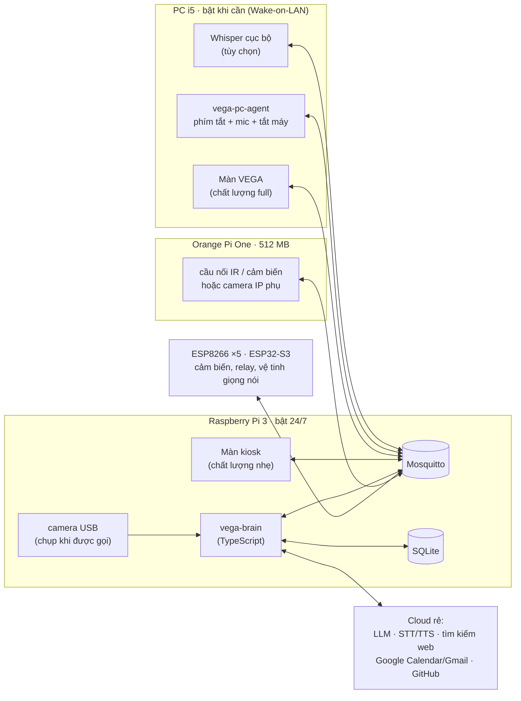

# VEGA 1.0 — Phương án sản phẩm

| | |
|---|---|
| **Ngày** | 2026-11-18 |
| **Trạng thái** | Đã duyệt (2026-11-18) |
| **Thay cho** | Brief 0001 (giao diện canvas). Bản nháp Brief 0002 bị hủy |
| **Template hình ảnh** | Nhánh `design/final`, thư mục `vega/` (VEGA Core, Three.js) |

---

## 1. Tóm tắt một trang

**VEGA là trợ lý cá nhân dùng thật hằng ngày**, chạy 24/7 trên Raspberry Pi 3, có màn hình FUI ở bàn và trên PC. Bản 1.0 làm **thật** 6 nhóm việc: phòng thông minh, trợ lý cá nhân, Dev/ChatOps, nghiên cứu có nguồn, camera (Vision) và vị trí (Locate). Ra lệnh bằng giọng nói tiếng Việt, thanh lệnh, và phím tắt kèm mic trên PC. Điện thoại tính sau.

**Ba ý tưởng xương sống:**

1. **Bộ não quyết định, màn hình chỉ hiển thị.** Bộ não gửi "cảnh" qua MQTT (`vega/ui/scene`), màn hình vẽ đúng template tương ứng. 11 màn của template trở thành 11 *bộ hiển thị* cho dữ liệu thật, không còn là kịch bản dựng sẵn.
2. **Cục bộ và miễn phí trước, cloud trả tiền sau.** Lệnh thường ("bật đèn", "mấy độ") do bộ phân tích cục bộ xử lý: 0 đồng, chạy cả khi mất mạng. Chỉ việc cần suy nghĩ mới gọi AI, bắt đầu từ model rẻ nhất, có trần chi phí theo ngày.
3. **Hỏng phần nào cũng có cách xử lý.** Mất internet, PC tắt, rút camera, rút mic, hết hạn mức API: mỗi trường hợp đều có hành vi định sẵn và hiện rõ trên màn. VEGA không bao giờ im lặng hay treo.

**Lộ trình:** 9 mốc (M0–M8). Mốc nào xong cũng là một bản dùng được. Khoảng **10–14 tuần** nếu làm đều cùng Claude.

---

## 2. Những gì đã chốt qua phỏng vấn

| Chủ đề | Đã chốt |
|---|---|
| Mục tiêu | Dùng thật hằng ngày: tin cậy và tiện trước, hiệu ứng sau |
| Màn hình | Màn riêng cắm Pi 3, và trình duyệt trên PC |
| Nhóm việc 1.0 | Phòng thông minh · Trợ lý cá nhân · Dev/ChatOps · Nghiên cứu có nguồn |
| Vision | Làm thật: camera USB cắm Pi, hoặc camera IP |
| Locate | Làm thật: vị trí lấy từ điện thoại (giai đoạn sau) |
| Ra lệnh | Giọng nói tiếng Việt ở bàn · Thanh lệnh · Mic PC + phím tắt. Điện thoại làm sau |
| Phần cứng | Pi 3 (1 GB) bật 24/7 · Orange Pi One (512 MB) · PC i5 8 GB **chỉ bật khi cần** (tiết kiệm điện) |
| AI | Chưa chọn hãng, ưu tiên rẻ nhất cho từng việc |
| Ngân sách | Rẻ càng tốt, tùy việc |
| Riêng tư | Chỉ một người dùng, nhưng **bắt buộc** có nút tắt vật lý hoặc rút được mic, camera mà hệ thống vẫn chạy bình thường |
| Ngôn ngữ bộ não | Claude chọn (xem D2) |

---

## 3. Kiến trúc



### 3.1 Vai trò từng máy

| Máy | Làm gì | Vì sao |
|---|---|---|
| **Pi 3** | Mosquitto, `vega-brain`, SQLite, luật tự động, chụp camera USB, màn kiosk ở chế độ nhẹ | Là máy duy nhất bật 24/7. Mọi thứ thiết yếu phải sống được chỉ với Pi 3 |
| **PC i5 8 GB** | Màn VEGA full hiệu ứng, phím tắt và mic khi code, Whisper cục bộ (tùy chọn), việc nặng | Mạnh nhưng tốn điện. Bộ não **bật PC bằng Wake-on-LAN** khi cần và tắt bằng lệnh. PC tắt thì hệ thống vẫn chạy |
| **Orange Pi One** | Việc nhẹ chuyên biệt: cầu nối hồng ngoại, cảm biến có dây, hoặc phát luồng camera thứ hai | 512 MB không đủ chạy trình duyệt hay bộ não, nhưng thừa sức cho một dịch vụ nhỏ |
| **ESP** | Cảm biến, relay, vệ tinh giọng nói ESP32-S3 | Như roadmap cũ |

### 3.2 Ngân sách RAM của Pi 3 (ước lượng)

| Thành phần | RAM |
|---|---|
| Pi OS Lite 64-bit | ~150 MB |
| Mosquitto | ~5 MB |
| `vega-brain` (Node.js) | 80–150 MB |
| Chromium kiosk, chế độ css/lite | 250–400 MB |
| Dư cho camera, zram | ~200 MB |

Vừa đủ, nhưng **không còn chỗ** cho WebGL bloom trên Pi 3. Kiosk trên Pi chạy chế độ `css` hoặc `lite`. Hiệu ứng full chỉ chạy trên PC.

### 3.3 Giao thức cảnh: biến template thành phần mềm

Bộ não là nơi duy nhất quyết định màn hình đang hiện gì:

```json
// vega/ui/scene  (retained)
{
  "v": 1,
  "scene": "research",
  "level": "normal",
  "orb": "think",
  "data": {
    "title": "CO₂ sensor for the bedroom",
    "step": { "current": 3, "total": 5, "label": "reading sources" },
    "sources": 12,
    "panels": [ { "kind": "chart", "series": "co2_24h" }, { "kind": "compare", "rows": [] } ]
  },
  "ttl": 600
}
```

- Mỗi template có một **schema dữ liệu** (zod), dùng chung cho bộ não và giao diện vì cả hai đều viết bằng TypeScript.
- Màn hình nào nhận được thì hiện. Kiosk Pi và PC hiện **cùng một cảnh**.
- Hết `ttl` thì tự về Idle.
- Quả cầu (`orb`) đi theo trạng thái thật của bộ não: chờ → nghe → nghĩ → nói.

### 3.4 Cách bộ não xử lý một lệnh

```
lệnh (giọng / thanh lệnh / phím tắt)
  → 1. Bộ định tuyến cục bộ: khớp mẫu + từ điển thiết bị. Khớp được thì làm luôn (0 đồng, chạy offline)
  → 2. Không khớp: gọi LLM rẻ, có tool calling
  → 3. Việc khó (nghiên cứu, đọc log dài): chuyển sang model mạnh hơn, dưới trần chi phí
  → mỗi lần gọi tool → hiện "chip" thật trên màn Think (không phải kịch bản)
  → kết quả → chọn cảnh + đọc câu trả lời (TTS)
```

---

## 4. Quyết định đề xuất

| # | Quyết định | Lý do |
|---|---|---|
| D1 | **Tên VEGA**, tiền tố MQTT `vega/`, chữ trên giao diện tiếng Anh như template | Đã chốt |
| D2 | **Bộ não viết bằng TypeScript (Node.js 22)**. Chỉ dịch vụ giọng nói cục bộ trên PC (nếu dùng) là Python | Template là JS, nên chung ngôn ngữ và chung schema giữa bộ não và giao diện. Node nhẹ trên Pi 3. SDK AI và MCP đầy đủ. Bạn chỉ phải giỏi một ngôn ngữ |
| D3 | **Giữ template ở `design/final` làm giao diện**, chuyển dần sang TS, thêm 3 mức chất lượng `full / lite / css` | Giữ đúng hình ảnh đã chốt. Pi 3 dùng css/lite |
| D4 | **Cổng LLM trung lập**: một lớp `llm` nói chuẩn OpenAI-compatible, cấu hình model theo từng loại việc (`router`, `chat`, `research`, `vision`) | Bạn chưa chọn hãng. Đổi hãng chỉ là sửa cấu hình. **Chọn hãng bằng số liệu**: bộ 50 lệnh tiếng Việt của chính VEGA, chạy thử 3–4 nhà cung cấp rẻ, so độ đúng, độ trễ, chi phí |
| D5 | **Định tuyến cục bộ trước LLM** | Phần lớn lệnh hằng ngày là lệnh thiết bị: miễn phí, nhanh, chạy offline |
| D6 | **Kiểm soát chi phí**: đếm token và tiền mỗi yêu cầu, trần theo ngày và tháng, vượt trần thì hạ model hoặc chỉ dùng cục bộ, báo cáo trên màn | Rẻ càng tốt mà vẫn chủ động |
| D7 | **Giọng nói theo tầng**: phím tắt + mic PC trước (không cần wake word) → mic ở bàn trên Pi → wake word "Hey Vega" (openWakeWord tự huấn luyện) → vệ tinh ESP32-S3. STT: API Whisper giá rẻ, hoặc Whisper cục bộ khi PC bật. TTS: Piper giọng tiếng Việt chạy **offline** trên Pi làm dự phòng, giọng cloud khi cần hay hơn | Có giọng nói sớm mà không đợi phần cứng. Mất mạng vẫn nói được |
| D8 | **Camera chỉ chụp khi được gọi**, không quay liên tục. Ảnh gửi model thị giác (có trả khung đối tượng), **mặc định không lưu ảnh** | Rẻ, nhẹ cho Pi 3, riêng tư |
| D9 | **Phần cứng có thể rút ra bất cứ lúc nào**: tự phát hiện khi cắm hoặc rút camera và mic, màn hiện "Camera unplugged / Mic off", lệnh liên quan trả lời rõ ràng. Hỗ trợ công tắc gạt vật lý hoặc đơn giản là rút cáp | Yêu cầu riêng tư của chủ dự án |
| D10 | **Dev/ChatOps bằng cách hỏi GitHub API mỗi 60 giây** trước, webhook qua tunnel để sau | Không cần mở cổng hay tunnel, đủ nhanh cho việc cá nhân |
| D11 | **Chế độ giả lập toàn hệ thống**: thiết bị ảo, camera ảo, dữ liệu mẫu | Phát triển và test trên PC khi chưa có phần cứng. Test tự động trong CI |
| D12 | **Repo `vega` dạng monorepo**: `brain/`, `dashboard/` (template), `pc-agent/`, `firmware/`, `packages/contract/` (schema chung), `infra/`, `docs/` | Một nơi, chung kiểu dữ liệu |

---

## 5. 11 màn của template sẽ thành thật như thế nào

| Màn | Dữ liệu thật đến từ | Mốc |
|---|---|---|
| **Idle** | Cảm biến phòng, mesh MQTT, CI, sự kiện kế tiếp, nhiệt độ/CPU Pi | M1–M3 |
| **Listen** | Mic PC/Pi, văn bản chép lời chạy theo thời gian thực | M5 |
| **Think** | Các lần gọi tool **thật** của bộ não ("Parse intent → Check devices → Plan actions") | M1 |
| **Research** | Tìm web (API tìm kiếm có gói miễn phí), đọc nguồn, so sánh, trích dẫn, biểu đồ | M6 |
| **Briefing** | Google Calendar + Gmail + thời tiết + phòng qua đêm + CI. Tự hiện khi radar thấy bạn dậy | M4 |
| **Focus** | Pomodoro, giữ thông báo, cảnh đèn | M4 |
| **Alert** | CI fail, thiết bị offline, CO₂ quá ngưỡng, Pi quá nhiệt | M3 |
| **Success** | Build hoặc deploy xong | M3 |
| **Sleep** | Cảnh "đi ngủ": tắt đèn, chống làm phiền, báo thức | M2 |
| **Vision** | Chụp camera USB/IP → model thị giác → khung và nhãn đối tượng | M7 |
| **Locate** | Vị trí điện thoại (app OwnTracks gửi qua MQTT) + bản đồ OpenStreetMap + chỉ đường | M8 |

**Màn mới cần thêm** (template chưa có): **Console**, một bề mặt quản lý gọn để làm thiết bị, luật, cảnh, lịch sử lệnh, bộ nhớ, chi phí, quyền hạn. Làm ở M8, giao diện đơn giản, không cần FUI.

---

## 6. Lộ trình 1.0

Mốc nào xong cũng là một bản **dùng được hằng ngày**. Chỉ sang mốc sau khi đạt "Xong khi".

| Mốc | Nội dung | Xong khi |
|---|---|---|
| **M0 · Nền móng** (1 tuần) | Monorepo, CI, `packages/contract` (schema MQTT + cảnh), template chuyển vào `dashboard/` với 3 mức chất lượng, giả lập thiết bị, Pi 3 cài Pi OS Lite + Docker + Mosquitto + kiosk | Trên PC và trên Pi, màn VEGA chạy bằng dữ liệu giả lập. Bắn một cảnh qua MQTT thì cả hai màn cùng đổi |
| **M1 · Bộ não v1** (1–2 tuần) | `vega-brain`: định tuyến cục bộ, cổng LLM, tool thiết bị, màn Think theo tool thật, đếm chi phí, chạy thử chọn nhà cung cấp AI | Gõ "phòng mấy độ, bật đèn" trên thanh lệnh thì trả lời đúng. Lệnh thiết bị không tốn lượt gọi AI |
| **M2 · Phòng thông minh** (2 tuần) | Node ESP8266 thật (môi trường, relay, IR qua Orange Pi hoặc ESP), luật YAML, cảnh, radar hiện diện, Sleep | Rút dây internet thì luật vẫn chạy. Nói "đi ngủ" thì cảnh chạy |
| **M3 · Dev/ChatOps** (1 tuần) | Hỏi GitHub API định kỳ, Alert/Success, "sao fail" thì AI đọc log, `/status` Pi, đèn LED CI | Push code lỗi thì trong 1–2 phút màn chuyển sang Alert, hỏi là có giải thích |
| **M4 · Trợ lý cá nhân** (2 tuần) | Google OAuth (Calendar, Gmail chỉ đọc), Briefing, nhắc việc bằng ngôn ngữ tự nhiên, Focus | 7 giờ sáng (hoặc khi bạn dậy) hiện Briefing đúng |
| **M5 · Giọng nói** (2 tuần) | `pc-agent` (phím tắt + mic + Wake-on-LAN + tắt máy), STT/TTS, mic ở bàn trên Pi, Piper offline, nhận biết rút mic | Nói từ bàn thì tổng độ trễ dưới 4 giây. Rút mic thì màn báo "Mic off" |
| **M6 · Nghiên cứu** (1–2 tuần) | Tìm web, đọc, tổng hợp, trích dẫn, giới hạn chi phí cho mỗi lần nghiên cứu | Hỏi một câu nghiên cứu thì có câu trả lời kèm ≥ 3 nguồn kiểm tra được |
| **M7 · Vision** (1 tuần) | Camera USB/IP, chụp khi được gọi, khung đối tượng, không lưu ảnh, nhận biết rút camera | "Trên bàn có gì?" thì màn Vision hiện ảnh thật kèm nhãn đúng |
| **M8 · Điện thoại + Console + hoàn thiện** (2 tuần) | Locate (OwnTracks), Telegram hoặc PWA, Console, backup, giám sát, OTA, tài liệu dựng lại từ đầu | Xóa thẻ nhớ, dựng lại toàn bộ từ repo và backup trong dưới 1 giờ |

---

## 7. Ma trận khi một phần bị hỏng

| Sự cố | VEGA làm gì | Màn hình |
|---|---|---|
| Mất internet | Lệnh thiết bị và luật vẫn chạy. Câu hỏi cần AI thì trả lời "offline, sẽ thử lại" | Chip "OFFLINE" trên header, quả cầu ngả màu dịu |
| PC tắt | Màn Pi vẫn chạy. Việc cần PC (Whisper cục bộ) chuyển sang API, hoặc hỏi "bật PC nhé?" | Callout "PC · asleep" |
| Rút camera | Lệnh Vision trả lời "camera đang rút" | Vision hiện "Camera unplugged" |
| Rút hoặc tắt mic | Thanh lệnh và phím tắt vẫn dùng được | Biểu tượng mic gạch chéo |
| Hết trần chi phí ngày | Hạ xuống model rẻ hơn, hoặc chỉ dùng cục bộ, rồi báo một lần | Chip "BUDGET" màu vàng |
| ESP mất kết nối | Đánh dấu offline trong vòng 1 phút, luật liên quan tạm dừng | Mesh "5/6", Alert nếu là thiết bị quan trọng |
| Bộ não crash | Docker tự khởi động lại. Màn giữ cảnh cuối rồi hiện "Reconnecting" | Không trắng màn |

---

## 8. Bảo mật và riêng tư

- Chỉ chủ nhân ra lệnh: thanh lệnh trong LAN và Tailscale, sau này Telegram thì khóa theo ID.
- MQTT có mật khẩu và ACL riêng từng thiết bị. Không mở cổng ra internet.
- **Nội dung từ bên ngoài chỉ là dữ liệu.** Email, log CI, trang web không bao giờ được kích hoạt hành động vật lý. Hành động nguy hiểm (tắt PC, mở khóa) luôn hỏi xác nhận.
- Camera chụp theo lệnh, không lưu ảnh mặc định. Mic chỉ gửi âm thanh sau phím tắt hoặc wake word. Có nhật ký mỗi lần camera hay mic được dùng.
- Bí mật nằm trong `.env`, không bao giờ commit.

---

## 9. Việc cần chủ dự án quyết hoặc chuẩn bị

1. **Duyệt phương án này**, hoặc ghi chỗ muốn sửa.
2. **Chọn hãng AI**: không cần chọn ngay. M1 sẽ chạy thử để chọn bằng số liệu. Trước M1 chỉ cần tạo 2–3 tài khoản API có gói miễn phí hoặc giá rẻ.
3. **Kiểm tra PC có bật được Wake-on-LAN** (BIOS + card mạng có dây). Không được thì dùng ổ cắm thông minh.
4. **Mua thêm** (ước lượng, chưa kiểm giá): SSD + adapter USB cho Pi 3, camera USB (hoặc dùng camera IP đang có), mic USB có công tắc, radar LD2410, cảm biến CO₂ SCD40.

---

## 10. Phần đã có và sẽ được dùng lại

Phiên triển khai trước (đang tạm dừng, nhánh `feat/vega-ui-v0.1`) đã có:
- Lớp dữ liệu: `MockSource`, `MqttSource`, parser, reducer.
- Hợp đồng MQTT v1, Mosquitto bản dev, script giả lập.
- Unit test.

→ Chuyển vào `packages/contract/` và `dashboard/` ở M0. **Giao diện Svelte theo canvas cũ sẽ bỏ.**

Khi phương án được duyệt, bước kế tiếp là viết **Brief M0** (scope + Definition of Done chi tiết) rồi giao cho phiên triển khai làm tiếp.
